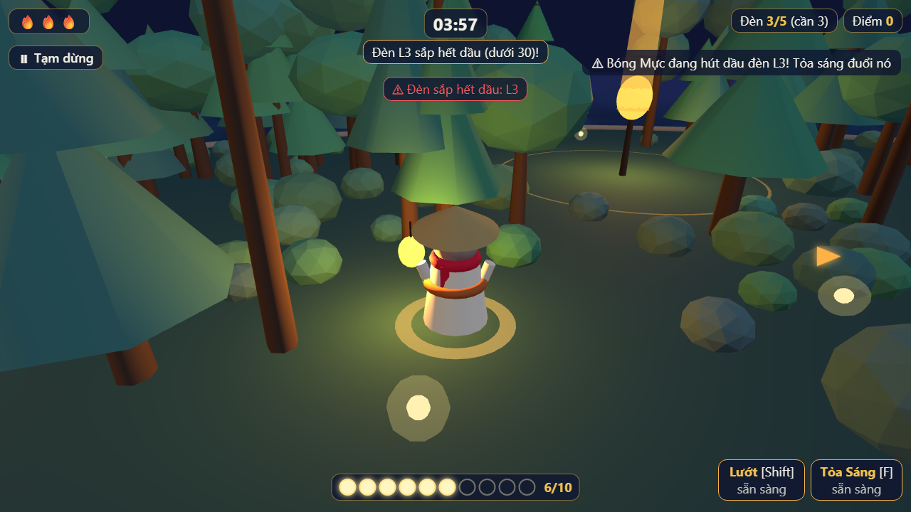

# Đảo Đèn Lồng

> **Video demo (dưới 5 phút):** [demo.mp4 trong Release v1.0.0](https://github.com/tiennguyen-ctrl/K5-L3A-DAY12-NguyenTranTien-2A202603504-AI-SDLC-Dao-Den-Long/releases/download/v1.0.0/demo.mp4) · [trang Release v1.0.0](https://github.com/tiennguyen-ctrl/K5-L3A-DAY12-NguyenTranTien-2A202603504-AI-SDLC-Dao-Den-Long/releases/tag/v1.0.0)



Game 3D góc nhìn thứ ba. **Mây**, người giữ đèn nhỏ tuổi (đội nón lá, treo một chiếc đèn lồng nhỏ), nhặt đom đóm để thắp và **giữ cho đủ Đèn Lồng Lớn sáng tới bình minh** qua **3 Đêm** trên 3 hòn đảo. Đèn cạn dầu thì tắt, phải châm thêm; **Bóng Mực** hút dầu của đèn yếu và **Gió Lạc** cướp đom đóm trong sương đen.

Bài lab Day 12 · AI SDLC (cá nhân). Đề bài và hướng dẫn của lab: [GUIDE.md](GUIDE.md), [CHECKPOINTS.md](CHECKPOINTS.md), [SUBMISSION.md](SUBMISSION.md), [RULES.md](RULES.md), [RUBRIC.md](RUBRIC.md).

## Yêu cầu hệ thống
- **Node.js ≥ 22.18** (macOS / Linux / Windows). Chạy thẳng file `.ts`, không cần bước biên dịch riêng.
- Trình duyệt hiện đại có **WebGL2** (Chrome, Edge, Firefox) để chơi. Chế độ benchmark cần **Chrome, Edge hoặc Chromium** cài sẵn (tự tìm; hoặc đặt biến `CHROME_PATH` tới file chạy).
- Chế độ headless, test, soak: chỉ cần Node, không cần cửa sổ hay GPU.

## Cài đặt và chạy (tối đa 3 lệnh)
```bash
git clone <link-repo> && cd <thư-mục>
npm install
npm run dev        # mở đường link Vite in ra (thường http://localhost:5173)
```
Bản build tĩnh: `npm run build` (ra thư mục `dist/`), rồi `npm run serve` mở http://localhost:8080 (máy chủ nhỏ có kèm bảng xếp hạng lưu ra đĩa). Trong game nhấn **F3** để hiện FPS. Ở menu có nút **Chọn Đêm** (chơi thẳng Đêm 1/2/3) và **Bảng xếp hạng**.

## Điều khiển (đổi được ở Cài đặt)
| Phím mặc định | Việc |
|---|---|
| `W` `A` `S` `D` | đi (theo hướng camera) |
| `Space` | nhảy (chỉ khi chạm đất) |
| `Shift` | lướt 14 m/s trong 0,2 s (hồi 1,5 s) |
| `E` | nạp ánh sáng / châm dầu cho Đèn Lồng gần nhất chưa sáng hoặc chưa đầy dầu (đang mang đom đóm) |
| `F` | tỏa sáng: xua Bóng Mực và Gió Lạc (tốn 3 đom đóm, hồi 3 s) |
| `←` `→` hoặc kéo chuột | xoay camera (cố định, không đổi được) |
| `Esc`, hoặc nút **⏸ Tạm dừng** | tạm dừng (Tiếp tục / Chơi lại Đêm / Cài đặt / Về menu). Game cũng tự tạm dừng khi bạn chuyển sang cửa sổ/tab khác |
| `F3` / `Enter` | hiện/ẩn FPS / tiếp tục ở các màn hình |

**Cài đặt** (được lưu): âm lượng, độ nhạy chuột, **đổi phím** cho 9 hành động (di chuyển 4 hướng, nhảy, lướt, tương tác, tỏa sáng, tạm dừng; phím trùng bị từ chối kèm báo; có nút "Khôi phục mặc định"), **Bảng màu dễ phân biệt**, **Giảm chuyển động** (tắt rung camera và chớp màn hình), **Chữ lớn ×1,25** (chữ UI tối thiểu 18 px ở 1280×720). Phụ đề và chỉ báo hình ảnh: Bóng Mực xuất hiện (kèm mũi tên chỉ hướng ở mép màn hình), gió sắp thổi, 10 giây cuối, đèn sắp hết dầu (< 30).

## Luật chơi (số chuẩn của Ticket-03, thay thế một số luật Ticket-02)
- **3 Đêm:** Đảo Bến (240 s, 5 đèn), Đảo Cau (270 s, 6 đèn, hai đảo nối cầu tre không lan can, bục nhảy), Đảo Chuông (300 s, 7 đèn, 3 tầng, dốc, bục nhảy, tháp chuông, gió mạnh). Thắng Đêm 3 ra màn Bình Minh với tổng điểm; thua thì chơi lại đúng Đêm đó.
- **Nhiên liệu đèn:** đèn mới thắp có 100 dầu, hao 1/giây. Mỗi đom đóm châm vào đèn đang sáng cộng 10 dầu (tối đa 100). Hết dầu thì đèn **tắt**; thắp lại chỉ cần **5** đom đóm (đèn chưa từng sáng vẫn cần 10).
- Sức chứa đom đóm = 10 + 2 × số lần thắp thành công trong Đêm, tối đa 20.
- **Thắng** khi còn sống lúc hết giờ (bình minh) và số đèn đang sáng ≥ 60% tổng (3/5, 4/6, 5/7). Thắp đủ đèn **không** kết thúc Đêm. **Thua** khi hết 3 Ngọn Lửa (luôn thua trước) hoặc hết giờ mà đèn sáng dưới ngưỡng.
- **Bóng Mực** đuổi khi Mây trong 12 m, bỏ đuổi khi quá 18 m. Chạm thì mất 1 Ngọn Lửa, rơi nửa số đom đóm đang mang, bất tử 1,5 s. Đèn còn từ 30 dầu trở lên tạo vùng an toàn 6 m; đèn yếu (< 30 dầu) mất vùng này và bị Bóng Mực lượn tới, đứng lại hút 5 dầu/giây cho đến khi bị Tỏa Sáng đẩy lui hoặc Mây châm dầu.
- **Gió Lạc** (Đêm 2, 3) cướp 3 đom đóm của Mây khi Mây mang từ 5 đom đóm trở lên; tỏa sáng đuổi được và lấy lại đồ.
- **Bùa Gió**: chạy 7,2 m/s và lướt liên tục trong 10 s. **Rơi khỏi đảo** thì mất 1 Ngọn Lửa và hết đom đóm, chờ 1 s rồi hồi sinh.

## Cách tính điểm
| Sự kiện | Điểm |
|---|---|
| Mỗi đom đóm nạp vào đèn (thắp mới, thắp lại, châm dầu) | +5 |
| Thắp lần đầu | +100 |
| Thắp lại | +40 |
| Mỗi Bóng Mực trúng Tỏa Sáng (mỗi con mỗi lần) | +5 (+15 nếu nó đang hút dầu) |
| Bình minh, khi thắng: mỗi đèn đang sáng | +50 + dầu còn lại (làm tròn xuống) |
| Bình minh, khi thắng: mỗi Ngọn Lửa còn lại | +50 |

Không còn thưởng thời gian. Tổng điểm game = tổng điểm các Đêm đã thắng.

## Bảng xếp hạng
Sau màn Bình Minh (thắng Đêm 3) hoặc sau khi thua ở bất kỳ Đêm nào, nhập tên (3–12 ký tự: chữ, số, `_`; chữ tiếng Việt có dấu được nhận) để lưu điểm. Giữ top 10, sắp xếp theo điểm giảm dần (bằng điểm thì ai đạt trước đứng trên). Mỗi mục: `name`, `score`, `nights_won`, `achieved_at` (ISO 8601 có múi giờ), `seed`. Với `npm run dev` / `npm run serve`, bảng lưu ra **đĩa** ở `data/leaderboard.json` nên còn sau khi tắt mở lại; bản web tĩnh thuần dùng `localStorage` của trình duyệt. Xem từ menu chính → **Bảng xếp hạng**. Xuất ra file:
```bash
npm run dev -- --export-leaderboard out.json     # ghi {"entries": [...]} đúng thứ tự rồi thoát
```

## Headless và Test Contract v1.3
Khai báo ở [game.contract.json](game.contract.json) (`tuning` là nguồn duy nhất, lõi game đọc trực tiếp từ file này; có `bench_cmd` và `soak_cmd`).
```bash
node src/headless/main.ts --seed 1 --night 2 --ticks 600 --out out.jsonl \
  [--scenario scenario.json] [--inputs inputs.json] [--snapshot-every 10]
```
`--night` nhận 1, 2, 3. 60 tick/giây cố định, không cần cửa sổ hay GPU; 21.600 tick chạy mất chưa tới 1 giây. Thoát 0 khi chạy xong hoặc game kết thúc; file inputs/scenario lỗi định dạng thì thoát 2. Đầu ra JSONL (`event`, `snapshot`, dòng `end`), tất định theo seed/scenario/inputs.

## Kiểm thử, benchmark, soak
```bash
npm test                 # 150 test: kịch bản headless 3 Đêm, tất định, hiệu năng, mã thoát, contract, luồng 3 Đêm, cài đặt, đổi phím, bảng xếp hạng, benchmark, soak
npm run typecheck
npm run proof            # chạy từng kịch bản qua CLI thật, ghi docs/proof/phase3/
node scripts/bot.ts      # bot chơi Đêm 1-2 và phát lại qua CLI (ghi docs/proof/phase3/bot/)
```
**Benchmark** (cần Chrome/Edge/Chromium; tự build bản web nếu chưa có):
```bash
node scripts/bench.ts --seed 42 --duration 30 --out bench.json      # (hoặc: npm run bench -- --seed 42 --duration 30 --out bench.json)
```
Cảnh chuẩn: Đêm 1 đầy đủ hiệu ứng và ánh sáng, đúng 200 Bóng Mực `wander` + 100 đom đóm, 3 đèn L1–L3 sáng fuel 100, Mây đứng yên ở (0,0,0), camera bay vòng tròn bán kính 30 m / cao 15 m / 15 s một vòng, canvas **1280×720** (cửa sổ trình duyệt hơi lớn hơn để chứa thanh tiêu đề), 3 s khởi động rồi đo đúng `--duration` giây và thoát mã 0. **Vsync:** tắt bằng cờ `--disable-gpu-vsync` của Chrome (`vsync_off: true`); trình duyệt vẫn chạy theo nhịp `requestAnimationFrame`. **Bộ nhớ:** bản web không đọc được RSS trong lúc đo nên `peak_mem_mb` = `null` (kèm `mem_after_run_mb` đo ngay sau khoảng đo). Thêm `--headless` để chạy không cửa sổ (giả lập GPU, chậm). Số đo trên máy của tôi (chỉ tham khảo): [docs/proof/phase4/bench.json](docs/proof/phase4/bench.json).

**Soak** (chỉ cần Node):
```bash
node scripts/soak.ts --seed 7 --nights 10 --out soak.json
```
10 Đêm liên tiếp trong cùng một tiến trình (Đêm 1→2→3 xoay vòng), Đêm thứ i dùng seed 7+i, input ngẫu nhiên theo seed. Kết quả: [docs/proof/phase4/soak.json](docs/proof/phase4/soak.json).

## Tài liệu và bằng chứng
- Spec, giả định, tiêu chí nghiệm thu: [Phase 4](docs/notes/phase4-spec.md), [Phase 3](docs/notes/phase3-spec.md), [Phase 2](docs/notes/phase2-spec.md), [Phase 1](docs/notes/phase1-assumptions.md)
- Quyết định thiết kế: [ADR-001](docs/adr/ADR-001-nhien-lieu-den-va-thang-luc-binh-minh.md) · Thay đổi phá vỡ tương thích: [CHANGELOG.md](CHANGELOG.md)
- Bảng truy vết yêu cầu → bằng chứng: [Phase 4](docs/proof/phase4-acceptance.md), [Phase 3](docs/proof/phase3-acceptance.md), [Phase 2](docs/proof/phase2-acceptance.md), [Phase 1](docs/proof/phase1-acceptance.md)
- Nhật ký dùng AI, đánh giá, token: [docs/notes/ai-log.md](docs/notes/ai-log.md) · Retro: [docs/notes/retro.md](docs/notes/retro.md)
- Harness cho agent: [AGENTS.md](AGENTS.md), skill [.claude/skills/verify-phase/](.claude/skills/verify-phase/SKILL.md)
- Nguồn asset/công cụ: [CREDITS.md](CREDITS.md) · Giấy phép: [LICENSE](LICENSE) (MIT)

## Cấu trúc
```
src/core/      luật game thuần (không DOM/three), dùng chung cho headless và web; maps.ts là 3 bản đồ chuẩn
src/headless/  CLI theo Test Contract
src/web/       Three.js: cảnh, bản đồ (world.ts), Mây (character.ts), rừng, HUD, luồng 3 Đêm, cài đặt, âm thanh,
               đổi phím (keybinds.ts), bảng xếp hạng (leaderboard.ts), cảnh benchmark (bench.ts)
tests/         test + kịch bản (cases.ts là nguồn chung của test và proof)
scripts/       run.ts (npm run dev), serve.ts, bench.ts, soak.ts, proof.ts, bot.ts, server-lib.ts
docs/          notes/ (spec, giả định, nhật ký AI, retro), adr/ (quyết định thiết kế), proof/ (bằng chứng theo phase)
```

## Sáng tạo của tôi
- **Rừng** quanh các đảo (`src/web/forest.ts`): vài trăm cây thông, cây tán tròn và bụi rậm bằng InstancedMesh; chừa trống quanh điểm xuất phát, đèn, bục nhảy, bùa; tự ẩn cây che giữa camera và Mây. Chỉ để trang trí, không va chạm.
- **Cột sáng** trên mỗi Đèn Lồng để nhìn thấy mục tiêu từ xa giữa rừng; đảo sáng dần lên khi thắp đèn; **thanh dầu**, đèn tắt xẹp và rách giấy, sợi hút dầu của Bóng Mực.
- **Chọn Đêm ở menu** để thử nhanh từng Đêm (tổng điểm tính từ 0).
- **Âm thanh tổng hợp** bằng Web Audio (không dùng file âm thanh nào): nhạc nền ngũ âm và hiệu ứng.
- **Lời Ông Đăng** giới thiệu từng Đêm, và các thông báo ngắn trong lúc chơi.
- **Bằng chứng phần cũ vẫn đúng:** các thành phần trên chỉ nằm trong `src/web/` và không import ngược vào `src/core/`; cảnh benchmark dùng cờ `Game.bench` mặc định tắt nên output headless không đổi (`npm test` 150 test, `npm run proof` 106 kịch bản). Trong cảnh benchmark mọi hiệu ứng sáng tạo dùng chung cảnh chuẩn nên không ảnh hưởng số đo.
